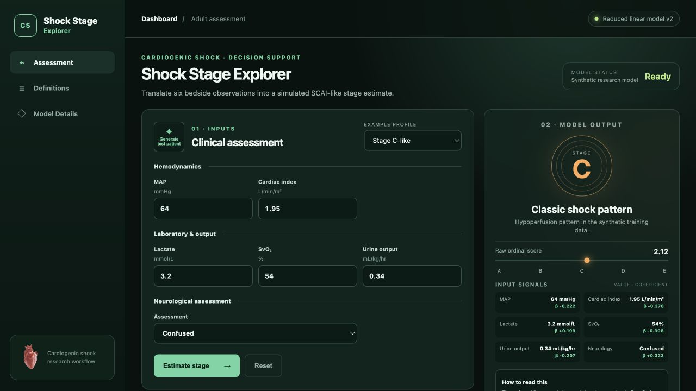
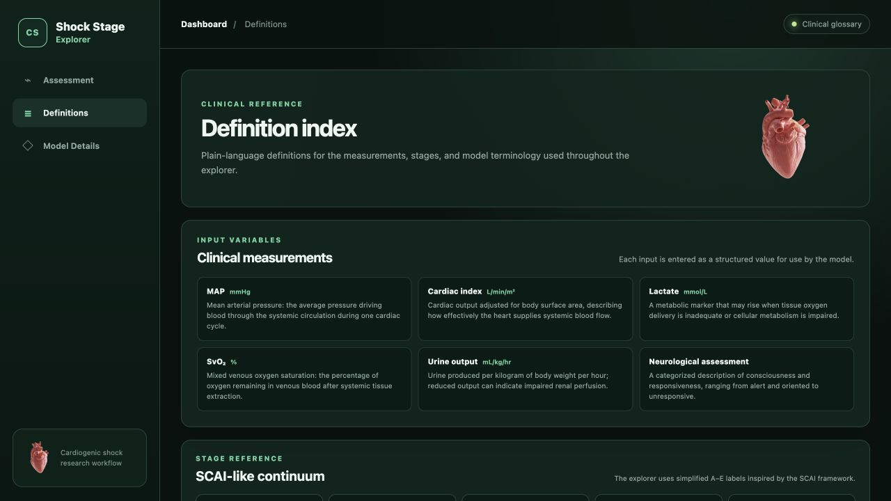
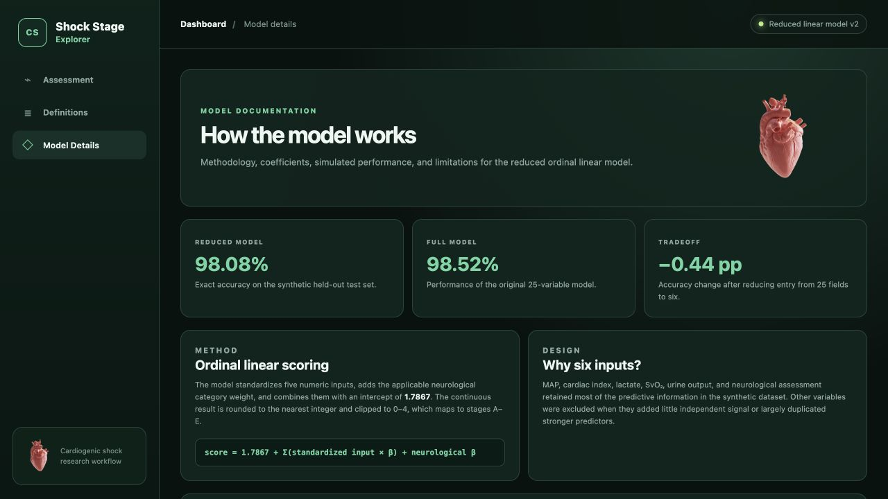

# Shock Stage Explorer

An interactive cardiogenic shock assessment dashboard that translates six bedside observations into a simulated SCAI-like stage estimate. The project also documents the reduced linear model, its coefficients, and the clinical terminology used throughout the interface.

[View the live dashboard](https://shock-stage-explorer.eliaszeller2.chatgpt.site)

> **Clinical disclaimer:** This dashboard uses a synthetic research model. It is an educational and workflow-development prototype, not a validated clinical decision instrument.

## Project screenshots

### Assessment

Enter MAP, cardiac index, lactate, mixed venous oxygen saturation, urine output, and neurological status to generate a simulated stage estimate.



### Definitions

Review plain-language definitions for the clinical measurements, SCAI-like stages, and analytical terminology used by the dashboard.



### Model Details

Explore the scoring method, synthetic performance metrics, coefficients, and model limitations.



## Key features

- Six-field clinical assessment with example patient profiles
- Simulated A–E stage estimate and raw ordinal score
- Input values displayed alongside model coefficients
- Dedicated clinical definitions and SCAI-like stage reference
- Transparent model methodology, performance, and limitations
- Responsive, browser-based interface with no server-side patient-data storage

## Run locally

Serve the `dist` directory with any static web server. For example:

```bash
python3 -m http.server 8000 --directory dist
```

Then open `http://localhost:8000` in a browser.
